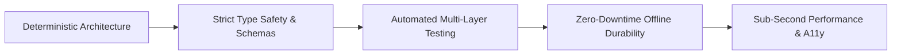

  

  

   

  
  
  
  
  
  

    

  <!-- High-Impact Verified Performance Highlights -->
  
  
  
  

## ◈ Executive Overview

I am a **Software Engineer** pursuing my degree at **Abasyn University Peshawar (CGPA 3.87 / 4.0)** and serving as an active **DIT Instructor** at Govt. Technical & Vocational Center. My engineering practice bridges core computer science theory with production-grade commercial software architecture.

I architect and deliver resilient digital products across four interconnected technical domains:
- 🏢 **Enterprise SaaS & Distributed Architecture**: Commercial multi-tenant platforms utilizing **Next.js 14 App Router**, **NestJS**, **FastAPI**, **Celery**, **Redis**, and **PostgreSQL 16**, complete with row-level tenant isolation, rate limiting, and 100% automated test coverage.
- 📱 **Native Mobile & Offline Distributed Protocols**: High-performance Android applications built with **Kotlin** and **Jetpack Compose (Material 3)** adhering strictly to MVVM + UDF patterns, alongside cross-platform **Flutter & Dart** systems featuring offline SQLite synchronization and direct peer-to-peer **Bluetooth Classic RFCOMM** socket streaming.
- 🤖 **Autonomous AI & Pipeline Engineering**: Deterministic, self-healing automation pipelines orchestrating **Python**, **Google Gemini GenAI**, **Pydantic**, and **GitHub Actions** for web crawling, dynamic data synthesis, automated vector PDF compilation (**ReportLab**), and scheduled email dispatches.
- ⚡ **High-Speed, Zero-Overhead Web Architecture**: Modern web platforms with static-first frameworks (**Astro**), component design systems (**Tailwind CSS v4**), and strict type validation (**TypeScript**), verified against perfect **100/100 Core Web Vitals** (LCP < 1.0s, CLS 0.0).

---

## 📌 Featured Engineering Showcase

### 🏢 Enterprise Multi-Tenant SaaS & Distributed Systems
<table>
  <tr>
    <td width="50%" valign="top">
      <h3>🎧 AudioDoc — Commercial PDF-to-Audiobook SaaS</h3>
      
Distributed commercial platform converting complex digital & scanned documents into high-fidelity neural audiobooks with studio-grade MP3 assembly.

      <ul>
        <li><b>Microservice Architecture:</b> Next.js 14 App Router frontend decoupled with a distributed Python FastAPI gateway and Celery worker cluster backed by Redis 8 & PostgreSQL 16.</li>
        <li><b>Dual-Engine Ingestion:</b> PyMuPDF column-aware structural parsing with 300 DPI Tesseract OCR fallback for scanned and damaged documents.</li>
        <li><b>Zero-Cost Neural Synthesis:</b> Edge Neural TTS engine with 100+ voices across 30+ languages, chunk-level FFmpeg audio concatenation, and ID3 metadata tagging.</li>
        <li><b>Enterprise Verification:</b> Verified across <b>87 / 87 automated tests (100% pass rate)</b> spanning Pytest, Vitest, Playwright browser E2E, and OWASP security audits.</li>
      </ul>
      

        <code>Next.js 14</code> <code>FastAPI</code> <code>Celery</code> <code>Redis</code> <code>PostgreSQL</code> <code>FFmpeg</code> <code>PyMuPDF</code>
      

      

        <a href="https://github.com/MTLab1122/PDF_file_conversion_to_Audio"><b>📂 View Repository</b></a>
      

    </td>
    <td width="50%" valign="top">
      <h3>🛒 Enterprise Cash & Carry SaaS & POS Platform</h3>
      
Complete multi-tenant retail management platform and offline-first Point-of-Sale ecosystem for wholesale supermarkets and retail chains.

      <ul>
        <li><b>Triple-Client Ecosystem:</b> Next.js 14 Web Management Dashboard, Windows Desktop POS (Electron + React + SQLite), and Mobile Supervisor App (Flutter + Dart).</li>
        <li><b>Offline POS Engine:</b> Sub-500ms barcode scanning, durable offline mutation queue with UUID idempotency, and automated replay sync upon network reconnection.</li>
        <li><b>Hardware Integration:</b> 80mm ESC/POS thermal receipt printing, cash drawer kick triggers, and GS1 standard EAN-13 barcode generation.</li>
        <li><b>Cryptographic Audit Ledger:</b> Double-entry customer credit khata chained with SHA-256 hash chains preventing retroactive record tampering. <b>169 / 169 verification assertions passing (100%)</b>.</li>
      </ul>
      

        <code>Next.js 14</code> <code>NestJS</code> <code>Electron</code> <code>Flutter</code> <code>Prisma</code> <code>SQLite</code> <code>TypeScript</code>
      

      

        <a href="https://mtlab1122.github.io/Cash-Carry-SaaS-POS-Platform/"><b>🚀 Live Web Demo</b></a> · 
        <a href="https://github.com/MTLab1122/Cash-Carry-SaaS-POS-Platform"><b>📂 View Repository</b></a>
      

    </td>
  </tr>
</table>

### 📱 Native Mobile & Distributed Protocols
<table>
  <tr>
    <td width="50%" valign="top">
      <h3>📶 BluetoothChat — Offline P2P Android Network</h3>
      
100% offline peer-to-peer encrypted messaging and file transfer mobile application operating without internet connectivity, cellular networks, or centralized servers.

      <ul>
        <li><b>Protocol Architecture:</b> Direct RFCOMM socket stream over Serial Port Profile (SPP) with newline-delimited framing and client/server pairing.</li>
        <li><b>Binary Chunking Engine:</b> 4KB binary payload chunking with end-to-end SHA-256 verification and automatic corrupted packet recovery.</li>
        <li><b>Local State Persistence:</b> Indexed SQLite database schema storing chats, message delivery states, and contact fingerprints locally.</li>
      </ul>
      

        <code>Flutter</code> <code>Dart</code> <code>Bluetooth RFCOMM</code> <code>SQLite</code> <code>Material Design 3</code>
      

      

        <a href="https://github.com/MTLab1122/BluetoothChat"><b>📂 View Repository</b></a>
      

    </td>
    <td width="50%" valign="top">
      <h3>🚗 CityDrive — Native Android Car Rental Platform</h3>
      
Production-grade native Android vehicle rental and urban mobility platform engineered with clean architectural separation and reactive state.

      <ul>
        <li><b>Native Architecture:</b> Kotlin with Jetpack Compose (Material 3), unidirectional data flow (UDF), and MVVM presentation patterns.</li>
        <li><b>Telemetry & Routing:</b> Live GPS tracking simulation, dynamic interactive map route rendering, and multi-tier booking calculators.</li>
        <li><b>Reactive Concurrency:</b> Asynchronous Kotlin Coroutines and StateFlow streams ensuring 60fps rendering without UI thread blocking.</li>
      </ul>
      

        <code>Kotlin</code> <code>Jetpack Compose</code> <code>Coroutines</code> <code>MVVM</code> <code>Material 3</code>
      

      

        <a href="https://github.com/MTLab1122/CityDrive_Mobile_APP"><b>📂 View Repository</b></a>
      

    </td>
  </tr>
  <tr>
    <td width="50%" valign="top">
      <h3>💍 ShaadiVenue — Banquet & Hall Reservation Platform</h3>
      
Native Android event venue booking ecosystem featuring role-based portals for Event Hosts, Venue Owners, and Admins with date conflict detection.

      <ul>
        <li><b>Role-Based Workflows:</b> Separate authenticated experiences for clients seeking banquet venues and hall administrators managing booking calendars.</li>
        <li><b>Collision Prevention:</b> Deterministic schedule availability verification preventing double-booking across multi-session events.</li>
      </ul>
      

        <code>Kotlin</code> <code>Jetpack Compose</code> <code>Material 3</code> <code>Multi-Role Auth</code>
      

      

        <a href="https://github.com/MTLab1122/ShaadiVenue_Mobile_APP"><b>📂 View Repository</b></a>
      

    </td>
    <td width="50%" valign="top">
      <h3>🖨️ Mukhtar Press & Store — Commercial Print Ecosystem</h3>
      
End-to-end commercial print production and e-commerce mobile application paired with an interactive React 19/Vite web showcase.

      <ul>
        <li><b>Automated Estimation:</b> Real-time dynamic quotation algorithms factoring paper stock, quantity, ink variants, and binding requirements.</li>
        <li><b>Cloud Data Layer:</b> Firebase Firestore real-time synchronization backed by granular security rules protecting customer orders.</li>
      </ul>
      

        <code>Flutter</code> <code>Dart</code> <code>Firebase Firestore</code> <code>React 19</code> <code>Tailwind CSS v4</code>
      

      

        <a href="https://github.com/MTLab1122/Mukhtar_Press_Mobile_APP"><b>📂 View Repository</b></a>
      

    </td>
  </tr>
</table>

### 🤖 Autonomous Agentic AI & Telemetry Intelligence
<table>
  <tr>
    <td width="50%" valign="top">
      <h3>🎓 KP & Charsadda Scholarship Intelligence Agent</h3>
      
Autonomous daily intelligence agent crawling, verifying, deduplicating, and reporting verified higher-education scholarships for regional students.

      <ul>
        <li><b>Three-Tier Trust Engine:</b> Strict source verification separating official <code>.gov</code> / <code>.edu</code> portals from unverified secondary aggregators.</li>
        <li><b>AI Synthesis & Deduplication:</b> Google Gemini API structured extraction, verbatim source quotes (up to 300 chars), and fuzzy string similarity deduplication (ratio >= 0.88).</li>
        <li><b>Multi-Format Automated Dispatches:</b> Executes daily at 07:00 PKT via GitHub Actions, compiling interactive HTML dashboards, ReportLab vector PDFs, and automated Resend email delivery.</li>
      </ul>
      

        <code>Python</code> <code>Google Gemini API</code> <code>GitHub Actions</code> <code>ReportLab</code> <code>Pydantic</code>
      

      

        <a href="https://github.com/MTLab1122/student-opportunity-intelligence"><b>📂 View Repository</b></a>
      

    </td>
    <td width="50%" valign="top">
      <h3>⚡ Autonomous Tech Intelligence Briefing Agent</h3>
      
24-hour self-operating market intelligence crawler executing parallel sweeps across frontier AI research, developer tooling, and trending repositories.

      <ul>
        <li><b>Multi-Source Ingestion:</b> Parallel scrapers across Hacker News, Hugging Face model registries, and GitHub trending API endpoints.</li>
        <li><b>Structured LLM Processing:</b> Strict JSON-mode synthesis with Gemini GenAI SDK, fallback heuristic engines, and deterministic schema validation.</li>
        <li><b>Publication Delivery:</b> Automated compilation into professional multi-page vector PDFs with dynamic tables, dispatched daily to engineering stakeholders.</li>
      </ul>
      

        <code>Python</code> <code>Gemini GenAI</code> <code>ReportLab</code> <code>Task Scheduler</code> <code>Resend API</code>
      

      

        <a href="https://github.com/MTLab1122/autoreport_agent"><b>📂 View Repository</b></a>
      

    </td>
  </tr>
  <tr>
    <td width="50%" valign="top">
      <h3>📊 Campus Environment Telemetry & Visualization</h3>
      
Full-stack environmental telemetry platform ingesting and visualizing ambient telemetry across 8 university campus zones.

      <ul>
        <li><b>Analytical Engine:</b> US EPA Air Quality Index (AQI) piecewise linear interpolation for PM2.5/PM10, ASHRAE thermal comfort indices, and Plotly 5-axis spider radar matrices.</li>
        <li><b>Automated QA:</b> 27 unit and integration tests passing via pytest covering models, REST API endpoints, and Dash callbacks.</li>
      </ul>
      

        <code>Python</code> <code>Flask</code> <code>Plotly Dash</code> <code>SQLAlchemy</code> <code>Chart.js</code>
      

      

        <a href="https://mtlab1122.github.io/Campus_Environment_DataVisualization_System/"><b>🚀 Live Web View</b></a> · 
        <a href="https://github.com/MTLab1122/Campus_Environment_DataVisualization_System"><b>📂 View Repository</b></a>
      

    </td>
    <td width="50%" valign="top">
      <h3>🏛️ University LMS & SRS Platform</h3>
      
Full-stack educational management platform with conflict-aware timetable algorithms, prerequisite validation, and complete IEEE-style SRS documentation.

      <ul>
        <li><b>Deterministic Scheduling:</b> Conflict detection engine eliminating room and professor double-bookings across departmental timetables.</li>
        <li><b>Academic Modules:</b> Dynamic credit hour billing, student registration, online quiz engines, and assignment workflows.</li>
      </ul>
      

        <code>Node.js</code> <code>Express.js</code> <code>JavaScript</code> <code>SRS Architecture</code>
      

      

        <a href="https://github.com/MTLab1122/Software_Requirement_Engineering_Project"><b>📂 View Repository</b></a>
      

    </td>
  </tr>
</table>

### ⚡ High-Performance Web & Full-Stack Systems
<table>
  <tr>
    <td width="50%" valign="top">
      <h3>🌐 Editorial Developer Portfolio</h3>
      
Production developer portfolio engineered with Astro's zero-JS static architecture, Tailwind CSS v4 design tokens, and strict TypeScript data contracts.

      <ul>
        <li><b>Performance Benchmarks:</b> 100/100 Core Web Vitals, sub-second LCP, zero layout shift (CLS 0.0), and zero base runtime client JS overhead.</li>
        <li><b>Technical SEO:</b> Full Schema.org JSON-LD semantic graph (Person, CreativeWork, ProfilePage), dynamic XML sitemaps, and automated robots directives.</li>
      </ul>
      

        <code>Astro</code> <code>Tailwind CSS v4</code> <code>TypeScript</code> <code>GSAP</code> <code>WCAG 2.2 AA</code>
      

      

        <a href="https://talha-portfolio-gules.vercel.app/"><b>🚀 Live Demo</b></a> · 
        <a href="https://github.com/MTLab1122/portfolio"><b>📂 View Repository</b></a>
      

    </td>
    <td width="50%" valign="top">
      <h3>👾 Modern Pac-Man Arcade Engine</h3>
      
High-performance retro arcade recreation built from scratch with modern React Hooks and requestAnimationFrame — zero external canvas game engines.

      <ul>
        <li><b>Autonomous AI State Machines:</b> Authentic recreation of 4 classic ghost behaviors: Blinky (chaser), Pinky (ambusher), Inky (random), Clyde (defender).</li>
        <li><b>Responsive Vector Rendering:</b> Scalable SVG sprites, direction input buffering, and full mobile touch controls alongside keyboard controls.</li>
      </ul>
      

        <code>Next.js 14</code> <code>TypeScript</code> <code>React Hooks</code> <code>Tailwind CSS</code>
      

      

        <a href="https://mtlab1122.github.io/Pac_Man/"><b>🚀 Play Online</b></a> · 
        <a href="https://github.com/MTLab1122/Pac_Man"><b>📂 View Repository</b></a>
      

    </td>
  </tr>
</table>

---

## 🛠️ Technical Ecosystem & Architecture Stack

### 💻 Core Programming Languages

### 🏢 Full-Stack & Distributed Backend

### 📱 Native Mobile & Hardware Protocols

### 🤖 Agentic AI, Document & Media Processing

### ⚡ Frontend Architecture & UI Craft

### 🚀 DevOps, Quality Assurance & Systems

---

## 🏛️ Engineering Principles & System Design Standards

- **Deterministic Offline-First Resilience**: Critical enterprise services must operate irrespective of network state. I implement durable local mutation queues, SQLite persistence, and idempotent background sync with exponential backoff and jitter.
- **Zero-Defect Quality Assurance**: Software is only as reliable as its automated verification suite. My flagship projects achieve 100% test pass rates across unit, integration, browser E2E (Playwright), and security tests (87/87 tests in AudioDoc; 169/169 assertions in Cash & Carry POS).
- **Strict Type Safety & Cryptographic Integrity**: Eliminating runtime defects through strict-mode TypeScript contracts, Kotlin type systems, Pydantic runtime models, and immutable SHA-256 cryptographic audit hash-chains for financial ledgers.
- **Zero-Overhead Web Performance**: Rejecting client-side JavaScript bloat by defaulting to static-first architectures (Astro), server components, and native CSS tokens, targeting 100/100 Core Web Vitals.
- **Accessible, Human-Centered UX**: Engineering WCAG 2.2 AA compliant interfaces with visible keyboard focus rings, group-aria states, zero layout shift, and smooth cross-device accessibility.

---

## 🎓 Academic & Professional Background

| Focus Area | Institution / Organization | Scope & Achievements |
| :--- | :--- | :--- |
| **B.S. Software Engineering** | **Abasyn University, Peshawar** | **CGPA 3.87 / 4.0** (2023–2027). Advanced coursework in Data Structures & Algorithms, Distributed Systems, Software Requirement Engineering (SRS), and Database Design. |
| **Technical Pedagogy & Instruction** | **Govt. Technical & Vocational Center, Umarzai** | **DIT Instructor (Ongoing)**. Mentoring vocational students in programming fundamentals, algorithm design, computing essentials, and practical software assignments. |
| **Commercial Print & Visual Systems** | **Mukhtar Printing Press** | **Computer Operator / Graphic Designer (3 Years)**. Production design, typography typesetting, and prepress vector engineering using Corel Draw, Photoshop, and InPage. |
| **Advanced Computing Fellowship** | **Presidential Initiative for AI & Computing (PIAIC)** | Specialized training in modern Next.js App Router, TypeScript strict typing, Tailwind CSS, and applied AI systems. |
| **Technical Internships & Programs** | **Abasyn, Pak Army (ISPR), NCHD & KP-TEVTA** | **5+ Technical Programs & Internships** across Android Mobile Development, Computer Technology On-Job Training, and Research (ORIC). |

---

## 📊 GitHub Analytics & Activity

  
  

  

  <picture>
    <source media="(prefers-color-scheme: dark)" srcset="https://raw.githubusercontent.com/MTLab1122/MTLab1122/output/github-contribution-grid-snake-dark.svg">
    <source media="(prefers-color-scheme: light)" srcset="https://raw.githubusercontent.com/MTLab1122/MTLab1122/output/github-contribution-grid-snake.svg">
    
  </picture>

---

## 🤝 Connect & Collaborate

I am actively open to discussing **Software Engineering roles**, **Enterprise SaaS development**, **Native Mobile (Android / Flutter) contracts**, and **Autonomous AI agent pipelines**.

| Channel | Destination | Primary Purpose |
| :--- | :--- | :--- |
| 💼 **LinkedIn** | [linkedin.com/in/mtlabs1122](https://www.linkedin.com/in/mtlabs1122/) | Professional Networking & Career Opportunities |
| 🌐 **Portfolio** | [talha-portfolio-gules.vercel.app](https://talha-portfolio-gules.vercel.app/) | Interactive Case Studies & Live Project Demos |
| 📧 **Direct Email** | [muhammadtalhapro1@gmail.com](mailto:muhammadtalhapro1@gmail.com) | Contract Inquiries, Technical Consulting & Hiring |
| 💬 **WhatsApp** | [+92 347 2937773](https://wa.me/923472937773) | Direct Instant Communication & Project Scoping |
| 🐙 **GitHub** | [@MTLab1122](https://github.com/MTLab1122) | Code Exploration, Architecture Audits & Open Source |

 

  
  Engineered with architectural precision by <strong>Muhammad Talha</strong> · Performance, Reliability, and Distinction.

