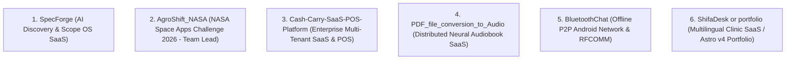

# Autonomous GitHub Profile & Portfolio Synchronization Report

**Executed At**: 2026-11-23 04:34:18 UTC  
**Target Profile**: [@MTLab1122](https://github.com/MTLab1122)  
**Total Public Repositories Discovered**: 68  

---

## 1. Discovery of Recent & High-Impact Projects

### Recent Projects (Created/Updated within 30 days)
- **AgroShift_NASA** (Created: 2026-11-15T06:16:09Z, 7 days ago)
- **AgroShift** (Created: 2026-11-13T17:01:31Z, 9 days ago)
- **SpecForge** (Created: 2026-11-11T04:13:56Z, 12 days ago)
- **Rental_Marketplace** (Created: 2026-11-09T12:25:44Z, 13 days ago)
- **ShifaDesk** (Created: 2026-11-09T10:47:03Z, 13 days ago)
- **PDF_file_conversion_to_Audio** (Created: 2026-11-09T05:41:16Z, 13 days ago)
- **Cash-Carry-SaaS-POS-Platform** (Created: 2026-11-08T15:25:35Z, 14 days ago)
- **Online_Car_Accessories_Shop_Website** (Created: 2026-11-05T03:27:52Z, 18 days ago)
- **BluetoothChat** (Created: 2026-11-03T14:51:02Z, 19 days ago)
- **Mukhtar_Press_Mobile_APP** (Created: 2026-11-03T14:58:38Z, 19 days ago)
- **ShaadiVenue_Mobile_APP** (Created: 2026-11-03T16:01:24Z, 19 days ago)
- **CityDrive_Mobile_APP** (Created: 2026-11-03T16:00:25Z, 19 days ago)

### Newly Added Flagships in Showcase
1. **SpecForge**: Discovery & Scope OS SaaS Platform (Next.js 15.5, Prisma, PostgreSQL 16, 49/49 verification checks)
2. **AgroShift (NASA Space Apps Challenge 2026)**: Team Lead, NASA Earth observation models (SMAP, GPM, MODIS, POWER), 74/74 pytest tests
3. **ShifaDesk (MatabAI)**: Multilingual Clinic Operations SaaS (Next.js 15 + NestJS 10 monorepo, WhatsApp scheduling)
4. **AudioDoc SaaS**: Commercial distributed PDF-to-Audiobook platform (87/87 tests passed)
5. **Cash & Carry SaaS POS**: Multi-tenant retail SaaS + offline Electron POS + Flutter app (169/169 assertions)

---

## 2. Profile README Synchronization Status
- **Status**: `IN_SYNC` — Profile README matches current repository state. Zero churn required.

---

## 3. Metadata Quality Audit (Missing Descriptions & Topics)

### Repositories Missing Descriptions
- `Rental_Marketplace`
- `khan`
- `html_1`
- `paractice_1`

### Repositories Missing Topics
- `Rental_Marketplace`
- `SDT_Class1_Task`
- `khan`
- `Lab_8_SC-D`
- `html_1`
- `SMIT_Classes`
- `paractice_1`
- `Atm`
- `Array-Assignment-for-Beginners`

---

## 4. Suggested Metadata Optimizations (Pending Approval)

| Repository | Recommended Description | Recommended Topics |
| :--- | :--- | :--- |
| **ShifaDesk** | Multilingual AI-Powered Clinic Operations SaaS Platform — Next.js 15, NestJS 10, Supabase, PostgreSQL 16 & WhatsApp scheduling | `clinic-management`, `emr-system`, `healthcare-saas`, `nestjs`, `nextjs`, `postgresql`, `prisma`, `saas`, `supabase`, `typescript` |
| **AgroShift_NASA** | AgroShift - NASA Space Apps Challenge 2026. Climate-resilient crop planning powered by NASA Earth observations for Peshawar Valley (Team InCir). | `agriculture`, `climate-resilience`, `earth-observation`, `fastapi`, `nasa-space-apps`, `nextjs`, `python`, `satellite-data`, `smap` |
| **AgroShift** | AgroShift Agronomic Decision Support Engine — NASA Space Apps Challenge 2026 climate reconciliation & crop rotation engine in Python/FastAPI. | `agritech`, `climate-data`, `decision-support`, `fastapi`, `nasa-power`, `nasa-space-apps`, `pydantic`, `pytest`, `python` |
| **SpecForge** | AI-assisted discovery, requirements, estimation, proposal, client-approval, and delivery-handover SaaS platform | `ai-agency-tools`, `estimation`, `nextjs`, `playwright`, `postgresql`, `prisma`, `project-management`, `saas`, `scope-management`, `typescript` |

---

## 5. Strategic Recommendations: Top-6 Pinned Repositories

